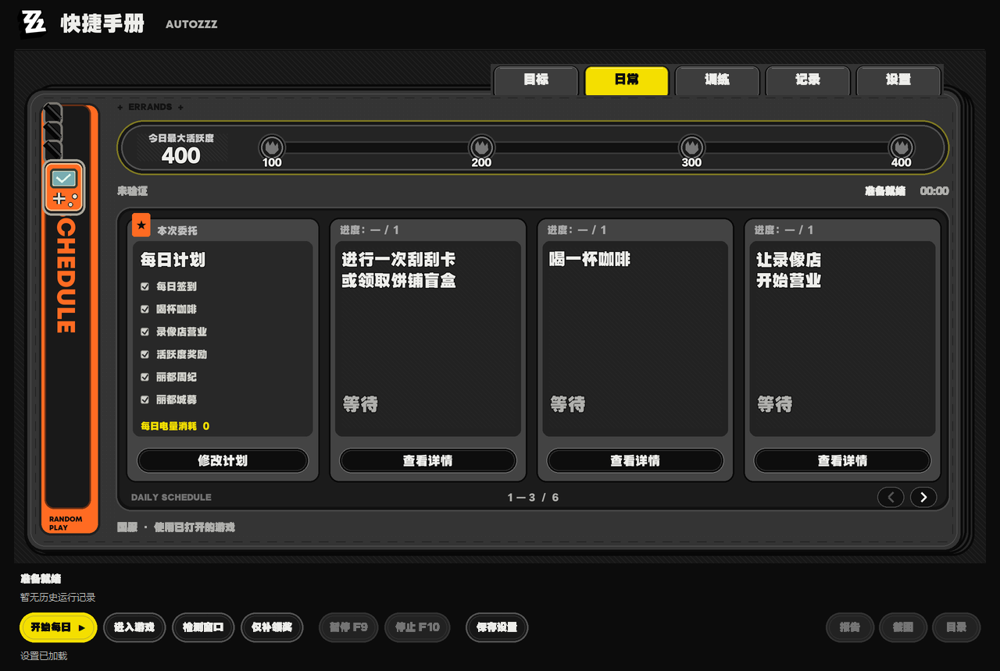
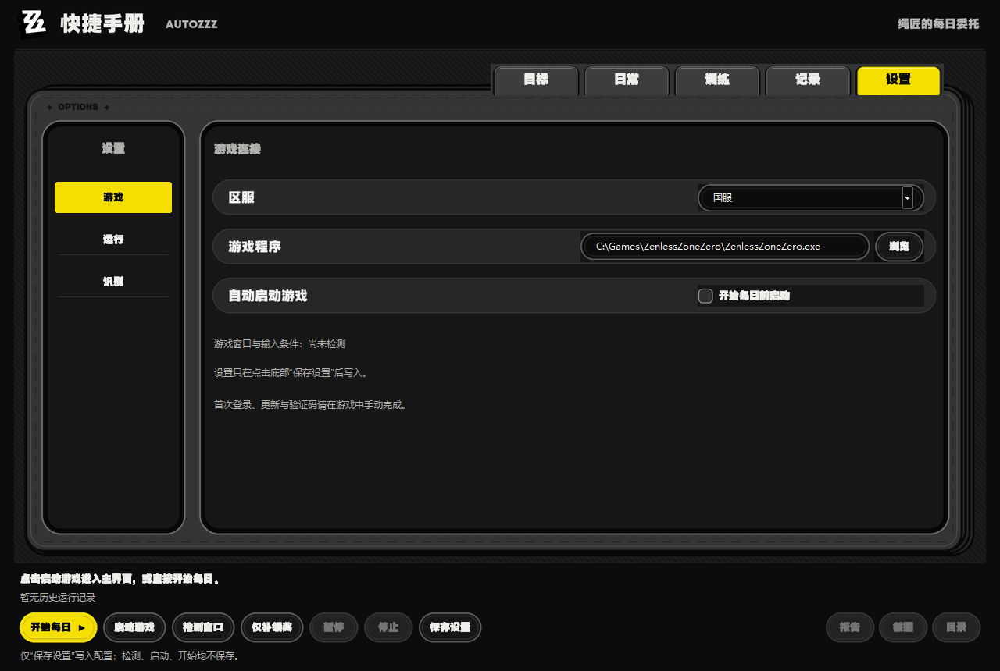

# AutoZZZ

> **本项目于 2026-10-28 恢复开发。** 后续以完善交互设计为重点，开发方向转向基于[绝区零一条龙](https://github.com/OneDragon-Anything/ZenlessZoneZero-OneDragon)的二次开发。现有代码尚未完成向上游执行框架的迁移。

## 开发缘起与方向

2026-10-28 以前，AutoZZZ 最初的设计仅受 [BetterGI](https://github.com/babalae/better-genshin-impact) 启发，主要参考其“屏幕识别 → 判断 → 模拟键鼠输入”的 I/O 交互逻辑，希望独立实现绝区零每日自动化。实现底座来自 AutoHSR；此前研究过程中也参考了[绝区零一条龙](https://github.com/OneDragon-Anything/ZenlessZoneZero-OneDragon)的流程，并引用了已署名的少量模板，具体来源保留在 [LICENSE_NOTICE.md](LICENSE_NOTICE.md)。

在知晓[绝区零一条龙](https://github.com/OneDragon-Anything/ZenlessZoneZero-OneDragon)已经提供完善的自动化能力后，我们一度认为继续重复实现这些能力，已使 AutoZZZ 作为独立项目失去存在价值，因此于 2026-10-26 宣布停止开发。

实际尝试绝区零一条龙后，我们希望进一步完善交互设计，于今日重新启动项目。**自 2026-10-28 起，AutoZZZ 的开发将更多地定位为基于[绝区零一条龙](https://github.com/OneDragon-Anything/ZenlessZoneZero-OneDragon)的二次开发**，重点探索更易理解的任务配置、策略管理、运行反馈与问题恢复。复用上游成果时保留原有署名、许可证及修改说明。

当前差异、可复用能力与迁移建议见[项目对比研究报告（2026-10-28）](REFERENCE_RESEARCH.md#comparison-20261028)。下文分别说明原有流程和正在接入的一条龙源码开发版。

完整迁移范围和验收状态见 [ONEDRAGON_INTEGRATION.md](ONEDRAGON_INTEGRATION.md)。已接入固定版本的一条龙独立进程、原生应用配置、条件策略编辑及应用运行窗口，本机构建的完整分发包同步包含已接入功能。2026-10-29 已通过国际服异常演练一场 20 电量的条件战斗实测；完整功能迁移和其他应用实机验收继续进行。现有每日和 JSON 预输入战斗继续保留。

通过游戏客户区截图、OCR / 图标识别和 Windows 鼠标键盘输入，执行《绝区零》每日任务及独立预输入战斗的桌面助手。参考 BetterGI 的屏幕识别原理，并从本机 AutoHSR 项目的窗口控制、OCR、运行控制与 GUI 基础发展而来。

仓库包含源码、构建脚本与脱敏测试素材；不提交本机配置、OCR 模型、打包程序和运行截图 / 日志。文档中 `runs/` 或 `dist/AutoZZZ/runs/` 的历史实机证据链接仅在原校准机器有效，克隆仓库后可自行运行并生成新记录。

默认使用国服，国际服提供独立启动路径与区服选项。国服和国际服均已于 2026-10-18 通过最终 EXE 从冷启动执行未完成日到 400 活跃及四档全领的连续实测；国际服同时实测领取月卡、选中指定宣传员薇薇安并开店。项目采用 [GPL-3.0-only](LICENSE)，代码与素材来源见 [LICENSE_NOTICE.md](LICENSE_NOTICE.md)。

## 自动战斗（试验）

顶部“训练”页默认使用一条龙条件战斗，按源识别、条件、优先级与操作执行器运行；完整范围及使用方式见 [BATTLE.md](BATTLE.md)。旧 JSON 预输入脚本保留在“预输入兼容”页。默认仅打一场、上限20现有电量，持久记录预算，不补电、不使用备用电或电池。当前实机主要校准“代理人晋升 → 异常演练”；其他模式与策略仍需分别验证。

### 一条龙条件策略（试验）

安装 [uv](https://docs.astral.sh/uv/) 后，在源码目录执行：

```powershell
powershell -NoProfile -ExecutionPolicy Bypass -File .\tools\setup_onedragon.ps1
```

安装脚本初始化固定版本子模块，并按上游锁文件建立独立 Python 3.11 环境；不向原 Python 3.12 环境安装上游依赖。首次使用时将版本控制中的资源复制到 `%LOCALAPPDATA%\AutoZZZ\OneDragon\cn` 或 `global`，已有文件不覆盖，也不读取其他一条龙安装目录的账号配置。

在源码目录运行 `.\.venv\Scripts\python.exe -m autozzz` 打开开发界面。2026-10-30 起本机构建的分发 EXE 也包含本节已接入的界面与独立运行时；启动脚本优先使用分发 EXE。请保留整个安装目录，其中 `onedragon` 提供固定上游源码、Python 3.11、实际 SDK 依赖及桥接代码，无需开发机原有的 Python 或 Git 路径。

界面“训练”默认打开“条件战斗”，提供实际上游的体力刷本、恶名狩猎、式舆防卫战、迷失之地、枯萎之都、情报板和三种助手运行入口；点击后仍须准备，并在运行窗口确认预算再开始。“预输入兼容”页保留原 JSON 表单及运行入口，两者设置独立。

“训练 → 条件策略…”可选择“自动战斗”或“闪避”，读取上游 YAML 策略、导入文件、校验草稿、改名另存及分别选择默认策略。校验使用实际 `AutoBattleOperator` 构建状态树、模板和原子操作，但不运行操作。内置策略保留作者信息并要求另存新名称。两类同名自定义策略分别保存，切换类型前保护未保存草稿；读取失败保留原内容。应用页也可配置并运行这些实际应用。

条件战斗及刷本运行窗口的“战斗状态…”读取当前上游执行器，展示策略、触发器、条件集、优先级、持续时间和已触发的状态；关键词将匹配项排在前面。面板不另开游戏连接，不修改战斗判断，停止后清除旧状态。新战斗功能以完整接入上游战斗能力为范围；后台、手柄及其他尚未验收项见接入清单，不能以一场成功代替全部战斗功能完成。

运行窗口右上角“调试追踪…”读取同一工作进程中的实际调试总线，按识别、决策、时间线、性能分组。支持关键词和识别来源筛选、冻结列表、清空及手动导出 JSON；长表达式和元数据在下方查看，超出显示限额时标明截断。冻结只影响列表，游戏覆盖继续使用最新数据。采集默认关闭，打开查看器后启用；关闭查看器会关闭采集，不暂停游戏任务。追踪快照只保留在内存，不进入普通运行报告。

“游戏覆盖”在前台游戏上显示识别框、条件、决策、时间线和性能，可分别开关图层、调整字号与不透明度。覆盖窗口不激活、不接收鼠标，并从游戏识别截图中排除；失焦、暂停、旧观察或无新画面时隐藏。账号轮换和重新准备复用原进程交接，清除旧数据后恢复订阅。实际模板、流程节点、条件引擎、OCR 模型及独立管道回放通过；游戏内覆盖、独立面板布局、热键及带覆盖截图等高级设置继续接入与验收。

“应用 → 读取配置”按日常、战斗、探索、辅助工具和运行环境分组，提供刷本计划、预编队伍、防卫战队伍、兑换码、执行顺序、挑战方案、键位、网络与模型等 33 组配置。副本使用逐级选择，计划与队伍使用表格编辑，优先级显示中文名称。国服与国际服分别保存；修改先留在草稿中，点击“保存配置”后校验并原子写入，文件被其他窗口修改时要求重新读取。

“应用 → 插件…”使用上游的实际插件导入器，支持 ZIP 或文件夹中的插件合集预览、选择安装、版本与作者显示、同名覆盖、降级确认，以及移除前归档和选择恢复。安装与恢复默认不加载；勾选允许执行插件 Python 代码后才能启用加载，代码拥有助手进程的权限。加载开关按区服持久保存，变更后须重新读取应用或重新准备任务。安装、移除、恢复及加载与游戏任务互斥；关闭窗口等待原作业和工作进程结束。

插件的公开可写配置属性在“其他应用”中显示，支持开关、数字、文本、枚举及 JSON 草稿；配置或工厂加载失败单独报告。插件市场、开发说明及项目主页由用户点击打开。插件应用运行入口与自定义专用界面的适配仍待接入，目前仅开放既有 30 个内置应用运行，不能把插件安装成功视为全部插件功能完成。

“运行环境 → 键位与镜头”编辑当前账号的键鼠、Xbox、DS4 映射、菜单组合键、点按时长、镜头参数与文本输入方式。键位须与游戏内一致；组合键按行顺序按住，完成后逆序释放，留空停用动作。保存配置不会立即操作游戏。

该页的“应用流程使用后台”控制普通应用；独立战斗和闪避助手使用“战斗设置”的后台开关。后台模式复用上游 Xbox/DS4 映射、条件执行器及窗口截图，窗口最小化时等待。必须使用鼠标或键盘的界面默认等待用户把游戏切回前台；“后台鼠标”可另选“短暂切回游戏后恢复”，会改变前台窗口和鼠标位置。F9 暂停、F10 停止仍有效。缺少虚拟手柄依赖或驱动时提示错误，不自动安装。实际源执行器与设备替身回放、原生测试窗口截图已通过，真实虚拟手柄及游戏内后台运行仍待验收。

顶部“画中画”独立预览游戏窗口，不启动游戏或任务，也不需要虚拟手柄。游戏在后台时显示，回到前台时隐藏；拖动窗口移动位置，拖动边缘或滚轮缩放，单击预览请求切回游戏。Windows 拒绝切换时，日志会提示手动切回。右键或右上角 × 临时隐藏，游戏下一次回到前台后重置；取消顶部开关则停止截图。游戏未出现、最小化或画面尚未就绪时等待。启用状态、尺寸和位置按国服、国际服分别记忆，开启后重新打开助手会继续预览。

画中画跟随当前运行任务的实际客户端，连续轮换切换客户端时会更新目标；切换区服则等待原连接退出后重建。预览图不进入每日或战斗识别，不解除 F9 暂停，也不向游戏发送操作。窗口移动和缩放只修改显示偏好，不使任务准备或预算确认失效。真实 SDK、源截图线程、独立管道与原生窗口显示链路已通过自建窗口回放，游戏内显示与切回仍需验收。

目前 30 个应用提供源码运行入口：原有日常对应应用、邮件、卦象集录、体力刷本、条件战斗、闪避助手、截图助手、预编队伍识别、鼠标灵敏度校准、情报板、迷失之地、枯萎之都、式舆防卫战、锄大地、兑换码、委托助手、指令调试、真·拿命验收、随便观、驱动盘拆解、恶名狩猎、通知和当前配置的一条龙应用组。先准备运行环境、配置和实际战斗模型，再点击“开始运行”；自动进入游戏沿用现有登录流程。窗口提供暂停、停止、日志、报告和资源预算，失焦等待恢复，F9 手动暂停不会因焦点恢复而取消。运行时限不计暂停时间。战斗助手需要已在游戏内进入战斗，自动选本使用“体力刷本”。

“应用 → 通知”配置各应用的开始、结束和节点通知；“发送渠道…”配置上游的 24 个实际渠道。新配置默认关闭自动通知和截图，每个渠道单独启用。已保存的凭据不回显，留空保留，勾选清除才删除。标题与通知时机按当前账号保存，同区服账号共用渠道，国服和国际服的数据隔离。“发送测试通知”只向当前已保存渠道发送固定文本，不附截图，也不启用自动推送。运行报告记录各渠道结果，部分发送失败不会显示全部成功；收尾等待发送队列结束。

QQ 官方机器人先保存 AppID 和 AppSecret，再点击“绑定单聊”或“绑定群聊”，按界面匹配码自行到 QQ 发送消息。绑定使用实际上游网关流程，成功后保存收件方，不自动启用渠道或发送测试通知。取消、关闭窗口或切换区服会等待原连接退出；状态查询失败继续观察原任务。绑定沿用发送代理，支持直连和 HTTP 代理；SOCKS 代理须另有 `PySocks` 与 `python-socks`，缺失时在请求前提示。渠道配置、生命周期、实际应用组、Webhook 传输接口与 QQ 网关协议已完成离线回放，未向外发送消息；各服务的真实账号绑定和投递仍需验收。

“应用 → 运行环境”可配置代理、资源下载源、截图方式、详细日志及 OCR、闪光、空洞识别模型。下载源使用上游仓库声明；项目模型可选推荐或备用版本，OCR 还可选择本数据目录内文件完整的本地模型。代理地址不回显，留空保留、勾选清除。保存后点击运行窗口的“重新准备”，旧工作进程确认退出后才加载新配置；一次准备到执行共用同一进程，等待超时不会重开任务。固定版本源码的自动更新、解释器安装及未接入的快捷键不在此表单提供。

网络与模型页面的“资源下载…”列出四类识别模型的七个声明版本，显示当前选择、本地文件和大小。使用已保存的下载源及代理，可下载或修复选中版本、查看进度及取消原任务；下载不改选模型。文件先在临时目录解压核对，齐全后整目录替换，旧目录保留在本区服归档中。安装中断时点击“恢复未完成安装”，恢复后再重新准备。关闭窗口会取消下载并等待原线程退出。下载管理已通过实际多源下载服务与内存测试包回放，正式服务的网络下载仍需验收。

迷失之地、枯萎之都、锄大地及挑战方案页面的“管理方案与路线…”打开原生资料库。可新建、另存、改名、导入/导出 YAML，以及归档和打开恢复草稿；修改内置资料时保存本地覆盖，恢复内置前保留当前版本的归档。仍被账号配置或路线组引用的自定义资料不能移除或改名，须先修改引用。另存支持当前未保存草稿，作者和其他元数据保留。“资料操作 → 资料问题”可查看无法读取的文件及错误原因。资料保存后，在应用页重新读取配置即可选择新增项目。

路线组可按区域添加路线并调整顺序；白名单按保存顺序执行，黑名单按完整路线原顺序排除。单条路线可选择起始传送点，通过地图点击、坐标弹窗和表格调整移动点。滚轮缩放、右键拖动，坐标以原始地图像素保存。

路线页“从游戏识别”截取所选区服已打开的游戏窗口，“从截图识别…”导入完整的 16:9 客户区截图。沿用上游的小地图裁剪、玩家标记、道路和图标匹配，显示候选坐标后，点击“追加到路线”才加入草稿。识别失败清空旧候选。截图不启动游戏或移动角色，失焦等待恢复，F9 暂停、F10 停止；关闭窗口等待原截图任务结束。

保存路线后可点击“调试路线…”，选择已完成的移动点数，在原生运行窗口准备并开始。0 从起点传送，大于 0 需要游戏已在对应点位附近。调试只执行这一条路线，不受当日已完成记录跳过，也不改写每日巡逻完成记录。地图或配置变化须重新准备。当前定位与调试通过实际 SDK、合成截图和设备替身回放，真实游戏录制与寻路仍待验收。

资料库切换到“大地图”后，按区域选择地图。可单帧取景、转镜头取景，或导入同一位置的 1—2 张客户区截图；预览保留两帧原小地图及合并后的道路。定位后可在地图点击调整候选中心、偏移、合并、回退、缩放及编辑图标。修改先留在草稿，“保存资料”才写入文件；缩放与边缘扩展同步迁移关联路线坐标，传送点改名同步修改路线引用，仍被引用的传送点不能移除。

地图、图标与关联路线作为整组保存并归档；保存中断时在“资料操作 → 恢复未完成保存”恢复原版本，再重新准备运行。已完成的归档也可整组恢复，归档后的资料存在其他改动时会拒绝覆盖。地图工具通过实际 SDK、合成截图、保存故障及界面回放；真实游戏双视角采集和导航尚待验收。

探索入口在出发前加载实际目标或空洞事件模型，核实挑战方案、候选队伍策略及巡逻路线。防卫战沿用上游的全编队扫描与弱点配队；迷失之地的优先代理人配队准备所有候选策略，矩阵行动未指定编队时使用编队一。无效的方案或路线名称会报错，准备期间文件变化也要求重新准备。重新准备会等待旧工作进程关闭，再重建策略和模型，停止准备不会显示为可开始。

委托助手的运行窗口提供“对话／闪避／战斗”选择，按当前配置显示模式快捷键；默认 5 切换闪避、6 切换战斗，F9/F10 保留为暂停与停止，冲突快捷键无法保存。指令调试和拿命验收沿用上游 YAML 与模板，在准备阶段展开并检查全部指令。失焦会释放按键，恢复后继续当前指令，已完成指令不重放；被中断的当前指令会重新执行。等待及指令前后延迟可立即停止。原 JSON 预输入战斗继续保留。

兑换码失焦后会重新聚焦输入框并全选替换未提交文字，避免拼接残留。已提交的代码不在输入节点重发。固定上游尚未区分兑换成功与失败结果，运行报告因此保留“已提交、到账未核实”；流程结束不等于奖励确认到账。

随便观与驱动盘拆解在准备后显示本轮资源操作，包含实际经营分支、材料、采购货币和拆解范围。消费或拆解须在该窗口明确勾选；确认只对本次已准备的配置有效，应用组统一确认，运行或重新准备后不能复用。仅领取托管收益并重启托管时无需消费确认。驱动盘的“额外包含全部已弃置”会扩大品质筛选范围，拆解无法恢复。

拆解先重置遗留筛选，再选择品质及弃置条件；筛选失败不会继续确认拆解。筛选中失焦会重新选择，已提交的筛选和不可逆确认不重发。没有获得材料的证据时，报告保留“拆解结果未核实”。消费节点和输入前都会核对配置，运行中变更须重新准备。随便观按满级玩法接入；当前固定上游未执行德丰大押，旧选项保留数据兼容并从有效表单隐藏。

“应用 → 账号…”管理上游账号配置，可新增、重命名、设为当前、设置是否参与一条龙和切换前重新登录，并独立保存游戏路径、服务器与登录设置。队伍、应用计划和运行记录按账号隔离。密码以明文保存在本机，读取时仅显示是否设置；空白保留原密码，清除需明确勾选。移除本机账号配置会保留目录归档和实例信息。选择当前配置不会立即切换游戏中的登录账号，多账号自动轮换仍在接入。

账号窗口的“轮换预检…”按上游参与清单和当前起点，逐账号列出应用、依赖、登录资料问题和客户端切换步骤；点击“编辑所选账号…”返回对应设置。预检不回显登录账号和密码，未保存的登录修改须先保存。连续多账号轮换和客户端交接仍在接入。

“登录此账号…”打开原生登录运行窗口，可选择沿用当前登录、从登录页重新登录，或从游戏内登出换号；选择其他配置时须先点击“使用此配置”。准备后点击“开始登录”，验证码在游戏中手动完成。勾选“未运行时启动游戏”只启动一次；已有进程尚未出现窗口时等待，另一客户端仍在运行时提示退出。暂停跨启动与登录保留，不激活失焦窗口；输入中断后全选替换，登录和登出确认尝试不重发，国际服进入前核实服务器，识别到大世界才显示成功。实际 SDK 与界面回放通过，实机登录及换号仍待验收。

账号页的“轮换预检 → 连续轮换…”可在源码版依次运行参与账号，并登录回本轮起点。运行页重新预检后显示逐账号进度、整轮共享战斗预算和消费清单；需确认的消费或拆解必须勾选后才能开始。准备后修改资料会使预检失效；受控切换账号和应用进度写入会传给下一工作进程。暂停、停止、未知战斗消耗及未核实的客户端退出会阻止后续账号启动。双账号同客户端换号及客户端切换通过实际 SDK、管道和工作进程的隔离回放，画面与设备为替身，尚未进行实机连续轮换验收。

“执行顺序”保存后可直接点击“运行应用组…”。当前入口调用真实上游一条龙及默认组，按当前账号已启用顺序运行，跳过已有完成记录的应用，并记录每项结果。部分应用失败时继续后续项，最终报告未完成项；已启用但执行适配尚未完成的应用会在准备时明确报出。整组共用本次预算。

体力刷本目前适配实战模拟室、区域巡防、专业挑战室和恶名狩猎的深度追猎。默认最多一场、20 现有电量；首次出战和“再来一次”均先登记持久预算，不补充电量或合成电池。深度追猎按当前画面核实消耗，并与固定上游的 60 电量设定核对；运行前须在预算中设置足够的总量与每场上限，超过上限时不预留、不点击。未识别到副本选择画面时等待；已经在配队页但没有本场预留记录时停止，避免绕过预算。停止后无法确认消耗的记录可在“预算记录…”按预留上限计入，电量额度不退回，战斗结果保持未知。

“恶名狩猎”独立入口只跑每周免费次数，不自动开启深度追猎。当前画面的免费次数无法识别时重试，不回退到旧缓存；免费模式不占电量预算，应用组可与深度计划一起运行。任务准备会加载队伍条件策略及目标模型，战斗、配队与移动继续调用实际上游流程。胜利结算才更新完成统计，重复处理同一结算不会重复计数；子战斗失败后，即使外层完成了收尾，也会报告计划未完成。运行窗口与报告分别显示已核实的免费和深度追猎场次。

`tools/onedragon_configuration_smoke.py` 验证真实上游的 211 个配置字段、专用列表保存、冲突拒绝及配置文件隔离；`tools/onedragon_configuration_gui_smoke.py` 验证表单、弹窗、界面添加刷本计划、实际保存和重新读取。配置页保留资源消耗、不可逆操作和输入格式提示；用分组、间距和按钮名称表达操作顺序。

`tools/onedragon_smoke.py` 使用真实独立进程检查 30 个应用注册、17 个应用配置快照、内置与自定义条件策略，以及错误名称、非法策略和未开放执行请求的拒绝。`tools/onedragon_engine_smoke.py` 用真实条件引擎配合记录型原子操作验证状态选择、优先级打断和停止；`tools/onedragon_gui_smoke.py` 检查原生策略窗口的导入、保存、默认选择、关闭等待及三种 DPI。它们不启动游戏，也不能作为实机战斗成功的证据。

执行适配层支持异步初始化、同一任务的状态查询与停止，以及受控前台键鼠、F9/F10、失焦等待、旧截图/线程池结果作废和共用任务锁。`tools/onedragon_initialize_smoke.py` 实际下载并加载上游 OCR；`tools/onedragon_battle_prepare_smoke.py` 加载实际条件策略与闪光模型并完成推理。`tools/onedragon_control_smoke.py` 使用真实上游 Operation、条件执行器、线程池和 RunSlot 回放控制，设备输入由记录器替代。`tools/onedragon_window_smoke.py` 用隐藏的测试子进程窗口核实进程绑定；`tools/onedragon_charge_smoke.py` 用过去截图和真实 OCR 回放首次出战、重复挑战及结算预算。它们均不操作游戏。

`tools/onedragon_exploration_prepare_smoke.py` 在独立测试目录通过真实进程准备五个新增应用，实际加载探索目标、事件与闪光模型并推理；`tools/onedragon_exploration_flow_smoke.py` 使用真实应用和配队算法回放初始化、优先代理人选队、路线顺序、策略替换、配置冲突与取消。两者均不绑定游戏，不将准备和回放视为实机通关。

`tools/onedragon_tools_prepare_smoke.py` 准备四种工具入口、检查真实指令展开和模式快捷键冲突；`tools/onedragon_tools_flow_smoke.py` 使用真实上游节点、RunSlot 和原子操作，配合记录器回放暂停恢复、按键释放、循环停止、模式切换与兑换输入。它们不会向游戏或实际设备发送输入。运行窗口在三种 DPI、国服、国际服及委托助手的 18 组布局中检查操作按钮、暂停和模式切换。

`tools/onedragon_resources_prepare_smoke.py` 检查实际托管、手动经营、拆解和应用组清单，以及未确认、旧确认的拒绝；`tools/onedragon_resources_flow_smoke.py` 使用真实节点与 RunSlot 回放筛选失败、失焦重选、确认不重发、获得证据、运行中配置变化及整组运行。消费操作和识别由记录器替代，未实际使用游戏资源。原生运行窗口新增资源清单与确认检查，累计覆盖三种 DPI 的 24 组布局。

`tools/onedragon_hunt_prepare_smoke.py` 实际准备每周免费、深度计划及两者组成的应用组；`tools/onedragon_hunt_flow_smoke.py` 用真实应用、节点和 RunSlot 配合合成数字画面及记录设备，验证免费三场、深度两场、预算与模式分离、失焦暂停、失败反馈、回调恢复和收尾入口。它不操作游戏；测试预算只写入独立测试目录。运行窗口加入免费入口检查，累计覆盖三种 DPI 的 30 组布局。

以上运行入口仍属试验功能。已记录的一场国际服 20 电量条件战斗通过，其余模式、真实后台与手柄组合仍需分别验收。完整分发包已通过实际 EXE 的离线环境检查及搬移目录后的真实模型准备，不能据此视为所有游戏玩法已验收；其余功能接入继续按迁移清单推进。

## 当前范围

每日页面执行不消耗体力的流程。自动战斗从独立页面启动，使用独立策略与现有电量预算。

| GUI 任务 | 配置键 | 目标行为 |
| --- | --- | --- |
| 每日签到（刮卡/盲盒） | `scratch` | 根据当日日常卡片前往报刊亭或吼吼饼铺，领取免费签到奖励并验证结果，或识别今日已完成 |
| 咖啡店喝咖啡 | `coffee` | 识别今日免费咖啡并核实领取；不能确认免费时停止该项 |
| 录像店营业 | `video` | 按填写的宣传员名字选择已拥有角色；留空或账号未拥有时选列表第一位，配置录像带并核实营业成功 |
| 验证活跃度并领取奖励 | `daily` | 读取当前活跃度，领取可领取的实训奖励，并核实满 400 活跃及四档奖励已领取 |
| 丽都周纪奖励 | `weekly` | 收尾时领取已完成任务的绿色卡片及亮星里程奖励 |
| 丽都城募奖励 | `city_fund` | 收尾时领取已有成长任务奖励，再按等级回馈红点领取等级奖励 |

设置页提供“每日确认完成后关闭游戏”开关，默认关闭。开启后仅在本轮 400 活跃、四档日常奖励及所有已选收尾奖励均核实成功时正常关闭对应游戏进程；失败、停止、未核实或收尾未完成时保留游戏，不强制结束，不关闭电脑或助手。开关保存为 `close_game_on_success`，旧配置默认关闭。

六项默认开启，两项收尾奖励可分别取消勾选。旧配置没有 `weekly` 或 `city_fund` 时默认开启，其他设置保留。咖啡可能恢复电量，程序不使用获得或已有的电量进行战斗；报告中的 `stamina_spent` 恒为 `0`。启动页显示“版本校对中”或“资源下载中”时持续等待，不因普通转换超时而报错或退出游戏，更新结束后继续原任务；F9 暂停和 F10 停止仍有效。首次登录、密码、扫码、验证码、协议确认、需要确认的更新和故事剧情需要手动处理。国际服已保存账号的入口仅在已识别 HOYOVERSE 标识、掩码账号和唯一“进入游戏”按钮时有限重试进入；不会填写账号凭据。购买、抽卡、体力补充与兑换不属于当前流程。

已购买月卡的每日领取票卡会自动处理：同一票卡区域需同时识别“今日到账”“月卡剩余”和 `×90` 奖励，才点击卡片领取，再重新识别进入每日。兼容“菲林 ×90”文字及只有菲林图标、`×90` 文字的实际画面；不将背后可见的主场景当作票卡已关闭。只有重新识别仍为同一领取画面时才有限重试，最多三次；购买、充值和续费页面不执行领取。这个分支已用 2026-10-12 的超时截图和离线流程回放验证，并在 2026-10-16 国际服进入游戏测试中实机领取成功。

**每日完成的终点是实际核实 400 活跃度已满且四档奖励已领取。** 开始时先检查这一状态，已完成就报告“每日任务已完成”，停止签到、饮品和录像店动作，再执行已启用的收尾领奖。执行途中取得同样证据也按此处理。周纪或城募的未完成、停止和未知页面会单独显示，已记录的每日完成结果不会因此变成失败。仅出现“今日最大活跃度 400”文字、满活跃但尚未领取全部奖励，均不算完成。

周纪有红点时进入，只有底部绿色且进度已满的任务卡可以领取；右侧只点击亮星里程点，跳过已领绿勾和未达黑圆。城募先检查成长任务的今日、本周、本期奖励，再复查等级回馈红点，有红点才领取等级奖励。世界场景的城募入口绑定图标下实际显示的快捷键，不固定假定 F2。不会为这些奖励完成周任务、消耗电量、购买等级、解锁城募或兑换物品；遇到奖励自选会留给用户处理。

在“宣传员（选填）”输入角色名字即可指定录像店宣传员，例如 `安比`、`爱芮`、`蕾米埃尔`。输入按内置名字与明确全名别名校验，错误名字会提示并阻止保存；旧配置没有 `promoter` 字段时默认留空。名单用于检查拼写，账号是否已拥有仍以游戏选择列表中的头像卡名字为准。

留空时选第一个可选宣传员；指定名字时先有限翻阅已解锁卡片，找不到会回到列表顶部选择第一位。已营业或每日已完成时不更换宣传员，经营页已核实指定角色时保留现有配置。2026-10-12 已在国际服未营业状态实测选中薇薇安、点击“确定”、核实角色槽，再打开空影片槽并“推荐上架”三部已有录像带；后续正式测试已开店并领取最后每日奖励。长角色介绍不影响页面识别，选择后等待当前角色标题，确认仅限右下角唯一“确定／确认”。内置名单按 2026-10-11 的 3.2 版本整理，新角色需要后续更新名单。

营业成功页兼容实机的“开店大吉，丁尼遍地！”及先前的“诚信经营，丁尼为本”，只点击位置已校准且唯一的确认按钮。确认开店或成功提示后若按 F9，恢复时继续只读等待结果，不重新开店。2026-10-18 两区服均已通过从关闭游戏开始、不中断执行未完成日的完整 EXE 运行，实际完成开店及每日领奖，400 活跃度、四档奖励已领取、体力消耗 0。

签到任务仍使用 `scratch` 配置键，已有配置无需改名。当前国服实机已通过日常“前往”到达吼吼饼铺，领取免费盲盒的 5888 丁尼；领取后活跃度从 100 增至 200，已完成的签到卡片离开当前可见任务列表。片刻闲的汀曼“来杯汀曼特调”对话已取得 80 电量奖励并确认领取；新版 M 键 3D 地图的快捷导航也已校准。

2026-10-11 的首轮逐项实机校准已完成国服当日 **400 活跃度与四档奖励领取**，电量从 240 增至 320，未消耗电量。随后完整 Runner 对这个已完成的每日重复运行，报告为 `success`、四项均 `ok`、`daily_verified=true`、`stamina_spent=0`；国服从未完成日开始的完整 EXE 运行已在 2026-10-18 后续验证通过，记录见 [VALIDATION.md](VALIDATION.md)。

国际服简体中文界面已在 **20:54:13–20:56:22** 通过一次完整源码运行：签到使活跃度从 100 增至 200，免费饮品获得 80 电量，录像店确认营业成功并返回大世界，最后核实 400 活跃和四档奖励已领取。报告四项均 `ok`、`daily_verified=true`、`stamina_spent=0`，实际耗时约 2 分 9 秒。

前版 EXE 在 **21:01:50–21:02:21** 通过国际服已完成日的实机重复验证，四项均 `ok`、400 活跃、全部奖励已领取且未消耗体力；已完成的签到、饮品、营业没有再次执行。本机封装 OCR、Win32 输入、F4 手册入口和奖励识别均正常。

冷启动首次测试遇到窗口已出现、初始画面尚未就绪的问题，现已加入首次有界只读等待。2026-10-11 的修复版 EXE 在 **21:12:18–21:13:42** 从正常关闭的国际服自动启动，初始画面未就绪时只读等待，两次点击已识别的标题页“点击进入游戏”后进入大世界，再通过已完成日的四项验证；实际耗时约 1 分 25 秒，体力消耗为 0。2026-10-12 又发现首张截图完全黑屏的分支，当前版仅在自动启动的首次截图中按界面超时重试，等待期间不发输入，F9 和失焦时间排除，F10 可停止。掩码账号面板、其他签到地点和每日重置仍待验证。画面证据和各版本记录见 [VALIDATION.md](VALIDATION.md)。

## 游戏与权限

适用于 Windows 10 / 11、简体中文游戏界面、16:9 客户区；建议先采用 1920 × 1080 窗口。游戏失焦或最小化时，助手暂停输入并等待，切回游戏后自动重新识别再继续，不抢前台。真正关闭游戏、无效窗口尺寸或未知页面仍会结束当前运行。

| 区服 | 默认游戏路径 | 研究状态 |
| --- | --- | --- |
| 国服 `cn` | `E:\miHoYo Launcher\games\ZenlessZoneZero Game\ZenlessZoneZero.exe` | 已通过最终 EXE 冷启动后的未完成日完整运行（2026-10-18） |
| 国际服 `global` | `E:\HoYoPlay\games\ZenlessZoneZero Game\ZenlessZoneZero.exe` | 简体中文界面已通过最终 EXE 冷启动后的未完成日完整运行（2026-10-18） |

GUI 切换区服会自动换到对应路径。安装位置不同可选择“浏览…”找到 `ZenlessZoneZero.exe`。已知官方路径与区服不匹配时，配置验证会拒绝运行。

切换区服前退出当前游戏客户端；另一官方客户端仍在运行时，助手会拒绝启动所选客户端，避免 `multi game detected`。快捷手册按图标下显示的唯一 F1–F4 按键打开，不假定所有账号都使用 F2：本次国际服实机为 **F4 手册、F2 战令**。国际服没有识别到手册图标及唯一按键时会停止输入。

**游戏以管理员运行时，助手也必须以管理员运行。** 普通权限可以读取窗口和画面，但 Windows 可能阻止向管理员游戏发送输入，表现为识别正常却点击 / 按键无效。源码使用 `Start-AutoZZZ-Admin.cmd`，并手动同意 Windows UAC 提示。普通启动器是 `Start-AutoZZZ.cmd`。

构建脚本为打包 EXE 添加管理员运行清单（`--uac-admin`），启动打包版时由 Windows 请求权限；每次启动仍可能弹出 UAC。助手不会自动确认这个系统提示。检测页显示的是**助手**权限，不应将这个字段当作游戏进程权限。

## 从源码使用

需要可运行 `venv` / `pip` 的 Python 3.10+；本机当前独立环境使用 Python 3.12.14。安装并运行：

```powershell
git clone https://github.com/HenryTANG0520/AutoZZZ.git
cd .\AutoZZZ
powershell -NoProfile -ExecutionPolicy Bypass -File .\setup.ps1
.\.venv\Scripts\python.exe -m autozzz
```

也可显式指定基础解释器：

```powershell
powershell -NoProfile -ExecutionPolicy Bypass -File .\setup.ps1 -PythonPath "C:\path\to\python.exe"
```

`setup.ps1` 创建 AutoZZZ 自己的 `.venv`，安装 `requirements.txt`，保留现有环境；不修改系统级 Python 或执行策略。上面的 `ExecutionPolicy Bypass` 仅作用于本次 PowerShell 进程。

本机调试环境因网络安装不稳定，先以同一个 Python 3.12 运行时建立独立 `.venv`，再从已安装的 AutoHSR 环境复制现成依赖。AutoZZZ 运行时使用自己的 `.venv`，不直接借用 AutoHSR 的解释器或改写其环境。这个复制方式仅用于当前相同 Python 版本的本机环境；其他机器按 `setup.ps1` 安装即可。

启动器优先运行 `dist\AutoZZZ\AutoZZZ.exe`，没有打包版时使用源码 `.venv\Scripts\pythonw.exe`。源码修改不会自动更新已有 EXE；开发时使用 `.venv\Scripts\python.exe -m autozzz`，重新构建后再用普通启动器。

## 界面与启动游戏

界面以《绝区零》实机“快捷手册”和“设置”为对照重建：灰色包边手册、缝线与纹理、橙色 SCHEDULE 书脊及挂件、上沿凸起页签、活跃度胶囊槽、纵向任务卡、灰色设置行与黄色焦点框。使用官网实际提供的印品鸿蒙体、Mont 字体和标志；字体、图标随程序离线打包，来源与校验值见 [素材说明](assets/ui/README.md)。

顶部“目标”配置每日任务与宣传员，“日常”查看真实任务状态，“训练”配置独立战斗，“记录”查看日志和报告，“设置”分为游戏、运行、识别。任务卡支持箭头、滚轮和左右键翻页；点击卡片或按 Enter 查看可滚动的完整详情。未验证的活跃度保持灰色，四档完成勾选只在本轮每日验证通过后显示。底部常驻执行、暂停、停止与保存操作。布局适配 100%—200% DPI。




“进入游戏”会启动所选客户端，处理已保存账号入口、标题页及已购买月卡的每日领取，直到识别到大世界或游戏菜单才显示“已进入游戏”。它不执行签到、饮品、开店、每日领奖或两项收尾；不要求启用“自动启动游戏”。首次账号验证、密码、协议和更新仍需手动处理。启动期间可暂停和停止，短暂黑屏仅在有界启动或已发送的入场转换中等待，其他阶段的截图异常照常报告。

运行期间在游戏左下方显示透明日志与状态，鼠标可穿透、不激活覆盖窗口；切走游戏时隐藏，切回后继续显示。可在“设置”关闭覆盖日志，配置键为 `overlay_logs`，旧配置默认开启。覆盖层使用 Windows 截图排除功能，不进入 OCR 截图；系统不能启用排除或鼠标穿透时会隐藏覆盖层并记录原因。

## 每日使用

1. 在“设置 → 游戏”选择区服并确认路径。已记住登录的会话可点击“进入游戏”进入主界面，或启用“自动启动游戏”后直接开始每日；首次登录、更新和阻塞弹窗仍需手动处理。也可先进入能自由行动的主场景再运行。
2. 按游戏当前权限启动助手。游戏为管理员时用 `Start-AutoZZZ-Admin.cmd`。
3. 点击“检测窗口”。助手最小化，识别游戏客户区，然后恢复；在“记录”的“窗口检测”标签核对尺寸、文字和截图。
4. 在“目标”勾选需要执行的任务，核对“日常”页计划后点击“开始每日”。仅“保存设置”写入配置，检测、启动和开始都使用当前表单快照；执行中锁定设置并最小化助手。
5. **F9 暂停 / 继续，F10 紧急停止。** 手动暂停时助手恢复，可查看说明并继续；也可点击“停止”。临时切换到其他窗口不结束任务，切回绝区零后自动继续；F9 手动暂停不会因焦点恢复而自动取消。等待时间不计入界面转换超时。
6. 结束后查看每项状态及每日验证结果，在“记录”的“运行报告”标签读取报告，或打开截图、报告文件和运行目录。

关闭执行中的助手会请求停止并等待后台线程结束、保存报告。未点击“保存设置”的表单修改不会写入配置；关闭时可选择保存、放弃或取消。失焦等待期间仍可停止；恢复后旧截图和坐标作废，不重复发送已完成的点击。遇到未知页面或验证失败时，查看报告与截图，恢复主场景后重新检测；不将一次点击当作成功证据。完整流程约束见 [DAILY_FLOW.md](DAILY_FLOW.md)。

## 命令行与记录

源码版一条龙也可通过 `--onedragon-run` 执行已保存的应用配置，与原生运行窗口共用执行会话和报告。例如，先在“应用 → 体力刷本”保存计划，再运行：

```powershell
.\.venv\Scripts\python.exe -m autozzz --onedragon-run charge_plan --server global --energy-limit 20 --battle-limit 1 --battle-cost-limit 20
```

三项预算必须同时明确指定；此入口只使用现有电量，不补充备用电或电池。`--budget-id` 可沿用原预算，待核对出战仍会阻止重开；`--no-auto-launch` 直接使用已进入游戏的窗口。Ctrl+C 请求停止并等待报告落盘。消费或拆解仍须在图形界面核对清单并确认，命令行不会代为确认。

```powershell
# 只检测，不点击任务按钮；默认使用国服配置
.\.venv\Scripts\python.exe -m autozzz --check --server cn

# 启动国服并进入已保存账号的主界面，不执行每日
.\.venv\Scripts\python.exe -m autozzz --launch --server cn

# 按保存配置执行非战斗每日
.\.venv\Scripts\python.exe -m autozzz --run --server cn

# 检测国际服；游戏界面使用简体中文
.\.venv\Scripts\python.exe -m autozzz --check --server global

# 执行国际服非战斗每日
.\.venv\Scripts\python.exe -m autozzz --run --server global

# 离线测试，不访问游戏
.\.venv\Scripts\python.exe -m autozzz --self-test
.\.venv\Scripts\python.exe .\tools\gui_smoke.py
.\.venv\Scripts\python.exe .\tools\ui_layout_smoke.py
.\.venv\Scripts\python.exe .\tools\compendium_smoke.py
```

支持 `--config "路径\config.json"` 和 `--game-path "路径\ZenlessZoneZero.exe"`。`--server` 先选择区服及默认路径，`--game-path` 再覆盖路径；命令行覆盖仅用于本次进程，不自动写回配置。运行命令在终端 `Ctrl+C` 时请求停止并等待报告保存。

| 运行方式 | 配置与记录位置 |
| --- | --- |
| 源码默认启动 | 项目目录 `config.json`、`runs\` |
| 打包版 | `AutoZZZ.exe` 同目录 `config.json`、`runs\` |
| 显式 `--config` | 配置使用指定文件；`runs\` 仍在源码项目或 EXE 所在目录 |

原每日与预输入功能的源码、打包配置及记录分别保存。一条龙源码版与分发版共用 `%LOCALAPPDATA%\AutoZZZ\OneDragon\cn` 或 `global`，更新程序不清空这些数据。GUI 仅点击“保存设置”时写入表单；检测、启动和开始不写入配置。每次任务保存 `run.log`、`report.json` 及关键画面 PNG / OCR 文本 `.txt`；检测另存 `check_...\check.json`。报告记录区服、路径、每日验证、活跃度及各项结果。`operation` 为 `daily` 或 `enter_game`；进入游戏成功报告只有 `launch` 完成项，不表示每日已完成。命令行不显示 GUI 覆盖日志。

每日是否完成以 `daily_verified=true` 且 `engagement=400` 的当次画面证据为准。日常终点已核实后，整体状态保留 `success`，周纪与城募仍分别记录真实的 `ok`、`partial`、`stopped` 或 `skipped`，界面会提示未完成的收尾项。未取得每日终点时，所选步骤成功只代表这些步骤完成。没有当日实机报告时，不根据离线测试或旧报告宣称每日完成。

打包版为无控制台 GUI；需要终端 JSON 输出时使用源码命令，使用打包版命令参数时读取 EXE 同目录 `runs\` 下的报告。

## 构建

完成源码依赖安装后运行：

```powershell
powershell -NoProfile -ExecutionPolicy Bypass -File .\tools\build.ps1
```

先安装 AutoZZZ 依赖并执行本节前述 `tools/setup_onedragon.ps1`。构建脚本使用 AutoZZZ `.venv` 中的 PyInstaller 生成主 EXE，再从固定 SDK 复制可移动 Python 3.11、实际安装依赖、固定上游源码和桥接源码；包含双方许可证、Python 许可证及依赖自带的许可文件。约 1.3 GiB 的一条龙运行时不包含账号、用户模型或报告。构建不安装虚拟手柄驱动，可选依赖以源 SDK 的实际安装情况为准。

程序启动前核实清单版本与文件摘要；缺失、变更或额外代码会明确报错，不回退到其他源码安装。已有账号文件不覆盖，源码环境继续核实 Git 固定版本。Windows 长路径在复制与清单检查中受支持。请保留整个 `AutoZZZ` 文件夹，放到可写目录，不能只复制 EXE。

构建先完成独立目录；`-StageOnly` 只生成该目录，`-NoAdmin` 用于普通权限的离线预览，默认产物仍请求管理员权限。发布前要求旧助手退出，保留 `config.json`、`battle.json`、`training_catalog.json` 和 `runs`，将旧包整体归档到 `build\previous-package-...`，再切换新包。发布失败时恢复原目录；旧包归档不会自动删除。

可用 `AutoZZZ.exe --runtime-check 新报告.json` 检查分发环境。检查只在独立资料目录读取应用、键位和策略并构建条件树，写入 JSON 后退出，不初始化游戏或模型。报告与对应 `.data` 目录必须使用新名称；无控制台 EXE 的结果以报告文件为准。

## 2026-10-16 UX 更新

运行控制采用与 AutoHSR 一致的交互约定；AutoZZZ 的视觉和导航按下述快捷手册设计。只有“保存设置”持久化；检测、启动、每日和“仅补领奖”使用当前表单的临时快照。关闭有修改的窗口时选择保存、放弃或取消。检测可停止：等待当前识别返回后丢弃结果，不执行任务。

启动页显示本次计划和已核实的准备条件；未检测或未知权限不会显示为已验证。历史报告标明时间、操作和来源，旧文件时间不等同于游戏日。失败结果同时显示原因、已确认事项、待核对事项和下一步。自动退出单独报告未请求、跳过、已退出或未确认，不覆盖每日奖励验证。

离线 GUI 验收使用 `python tools/ux_smoke.py`（`gui_smoke.py` 兼容入口），所有游戏后端均替换为假对象，配置存于临时目录。此更新没有进行真实游戏任务、资源消耗或战斗验证。

## 2026-10-22 UI 更新

按网上实机参考重建快捷手册和设置控件，替换原侧栏 / 磁带方案。`autozzz/theme.py` 管理原字体、胶囊控件、焦点及 DPI；`autozzz/game_widgets.py` 绘制手册和实时任务卡；`autozzz/desktop.py` 接入现有功能。游戏截图不作为程序背景，参考图中的固定进度、账号信息和水印不随程序分发。

`tools/ui_layout_smoke.py` 覆盖三个 DPI、默认 / 最小窗口、五个页面及三个设置子页，共 42 组边界和文本检查。`tools/compendium_smoke.py` 覆盖任务翻页、键盘导航、真实进度、长详情、设置草稿及执行时禁用控件；均不启动游戏。`tools/capture_ui.py` 用临时通用配置重建上述文档预览。

## 2026-10-28 界面文字整理

每日计划按“每日任务 / 收尾奖励”分组，移除重复释义、页面介绍和口号。按钮直接标明“进入游戏”“准备队伍（不出战）”，保存状态只显示已加载、未保存或已保存。输入格式、错误原因、自动关闭条件、电量上限与策略文件覆盖关系继续显示。

本次只调整现有界面的文案、分组和间距，没有接入一条龙执行框架。检查包含同一页面修改前后的截图、离线布局与操作回归；未进行用户可用性测试，不据此声称完成率或操作速度提高。

[每日计划预览](docs/images/daily-plan.png) · [训练预览](docs/images/training.png)
